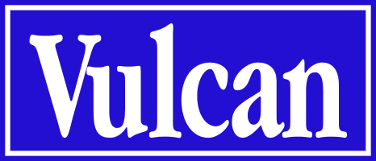

	 
	Vulcan is a powerful programming language based on the likes of Scratch 1.4.

> [!WARNING]
> The version of Vulcan featured *here* is a work-in-progress development build. If
> you would like to download a more stable version of Vulcan, then please go to
> (insert itch.io link once finished) or to the releases tab.

# Features

For a full list of features, go to (insert itch.io link once finished).
* Clipboard History - When you delete something (e.g. a background, a sprite, a sound, code blocks, etc.), Scratch 1.4 saves it to a clipboard. That clipboard can only contain one item at a time. Clipboard History makes sure *everything* is saved onto the clipboard so that if you accidentally delete more than one item, you can easily recover them without fear of losing your work. With Clipboard History, the clipboard can theoretically hold a limitless amount of images, sounds, sprites and code blocks.

# Installation

To install a stable build of Vulcan:
* Download the Vulcan installer or 7Z archive from either itch.io or the releases tab.
* If you downloaded the archive, unarchive it using software such as 7-Zip or WinRAR.
* If you downloaded the installer, there is no need to unarchive it and you may open it straight from the box.
* If you downloaded the installer, follow the installation instructions and install the components of Vulcan that you want.
* If you downloaded the archive, you will be able to use Vulcan straight out of the box.

To install a nightly/development build of Vulcan:

* Download the Vulcan source code by clicking the green 'Code' button at the top of the page, then clicking the 'Download ZIP' option at the bottom of the menu.
* Unarchive the ZIP archive using software such as 7-Zip or WINRAR.
* Navigate to the Vulcan development build directory by going to `\dev\`.
* Open the Vulcan executable file.

# Disclaimer

This project is in no way affiliated with Scratch, the Scratch Team, the Lifelong Kindergarten Group or the Massachusetts Institute of Technology.